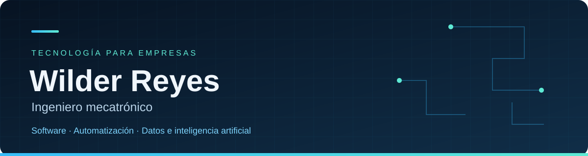

### Soluciones tecnológicas para impulsar empresas.

## Sobre mí

Soy **ingeniero mecatrónico por la Universidad Tecnológica del Perú (UTP)**. Desarrollo **soluciones tecnológicas para empresas**, combinando software, automatización, análisis de datos e inteligencia artificial para resolver necesidades del negocio.

Transformo necesidades operativas en aplicaciones e integraciones a medida, con foco en la eficiencia, la experiencia del usuario y resultados que puedan medirse. Mi experiencia incluye soluciones de comercio electrónico para búsqueda de productos, procesos de compra y gestión de pedidos.

Me interesa llevar una idea desde la investigación y el prototipo hasta una experiencia que las personas puedan utilizar y entender.

- **Soluciones empresariales:** aplicaciones web, APIs e integración de sistemas.
- **Automatización:** digitalización de tareas y mejora de procesos operativos.
- **Inteligencia artificial:** aprendizaje automático y visión artificial como herramientas según el problema.
- **Datos para decidir:** análisis, visualización e información satelital aplicada.
- **Idiomas:** español e inglés avanzado.

## Tecnologías

**Lenguajes**

**Desarrollo de software**

**Datos y análisis**

## Proyectos destacados

<table>
<tr>
<td width="50%" valign="top">
<h3>01 · CHACKRA-X</h3>

Plataforma de apoyo a la planificación agrícola por zonas: mapas, registro de cultivos y propuestas orientativas de próximas siembras con fuentes NASA y criterios agronómicos.

<strong>React · TypeScript · FastAPI · Datos satelitales</strong>

<a href="https://github.com/Wilder-reyes/CHACKRA-X">Explorar repositorio →</a> · <a href="https://chakrax.vercel.app/">Ver aplicación ↗</a>

</td>
<td width="50%" valign="top">
<h3>02 · HuYOLO-NAS</h3>

Prototipo de investigación en visión artificial que explora YOLO-NAS y momentos de Hu para detectar y clasificar residuos sólidos reciclables.

<strong>Python · Jupyter · Detección de objetos</strong>

<a href="https://github.com/Wilder-reyes/HuYOLO-NAS">Explorar investigación →</a>

</td>
</tr>
<tr>
<td colspan="2" valign="top">
<h3>03 · BOX-IT</h3>

Equipo participante del CAJATHON 2026 en el área de Negocios.

<a href="https://github.com/Wilder-reyes/BOX-IT-CAJATHON-2026">Conocer BOX-IT →</a>

</td>
</tr>
</table>

**Otros proyectos:** [ElderAid](https://github.com/Wilder-reyes/ElderAid) · [Kawsay](https://github.com/Wilder-reyes/Kawsay)

## Mi enfoque

**Entender el problema → construir un prototipo → evaluar con evidencia → mejorar la experiencia.**

Combino la perspectiva de la mecatrónica con el desarrollo de software y el análisis de datos. Elijo las herramientas según las necesidades de cada empresa y evalúo su utilidad con indicadores concretos.

---

### Conectemos

Para conversar sobre soluciones tecnológicas, automatización y desarrollo de software para tu empresa.

[LinkedIn](https://www.linkedin.com/in/wilder-reyes/) · [Proyectos en GitHub](https://github.com/Wilder-reyes?tab=repositories)

Wilder Reyes · Ingeniería, datos y tecnología con propósito.

